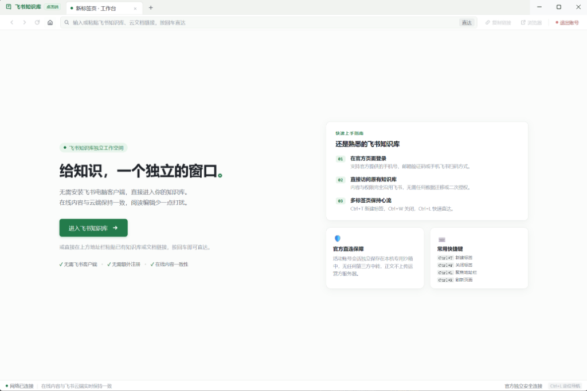

# 飞书知识库客户端 (Feishu Wiki Desktop)

<p align="center">
  
  
  
  
</p>

<p align="center">
  <strong>专为知识工作者打造的独立、轻量、专注的飞书知识库桌面客户端。</strong><br>
  无需安装笨重的飞书全功能电脑端，摆脱在浏览器几十个杂乱标签页中频繁寻找知识库的困扰，给知识创作与沉淀一个纯粹的桌面视界。
</p>

<p align="center">
  
</p>

---

## 💡 为什么需要独立客户端？

* **告别 IM 干扰与过载**：官方飞书客户端集成了即时聊天、音视频会议、日程邮件等海量模块，日常写作查阅容易频繁被消息弹窗打断。独立客户端只专注知识库本身。
* **免除企业管理员开通门槛**：不依赖企业自建应用、不需要管理员审批应用权限。无论是大型企业成员、初创团队还是无企业归属的**个人用户**，只要拥有飞书账号即可直接使用。
* **独立的沉浸式工作流**：在系统浏览器中使用网页版时，文档标签常常淹没在海量网页中，或者因误触浏览器关闭而打断思路。本客户端提供独立的窗口托盘、多标签页以及针对知识库深度调优的界面体验。
* **安全直连与隐私保障**：**绝不架设任何第三方正文托管后端**，本客户端 100% 直连飞书官方服务，所有文档与登录凭证保存在本地沙箱，保障企业与个人数据绝对安全。

---

## ✨ 核心特性

- 📑 **多标签并行心流**：支持同时打开多个知识库空间、长篇文档、电子表格（Sheets）与多维表格（Bitable），按 `Ctrl+T` / `Ctrl+W` 流畅切换。
- 🖥️ **紧凑一体化顶栏（74px Compact Header）**：相比传统浏览器外壳大幅节省近 50% 的顶部死区空间，让高密度文档在主流 1080p 笔记本屏幕上拥有最大可视视距。
- 📋 **智能剪贴板感知**：复制任何飞书文档或知识库链接切回客户端，自动弹出直达卡片，一键即刻打开。
- ⚡ **微动效与加载透明化**：内置 2px 品牌流动微进度条与优雅的人性化异常诊断卡片，消除传统网页容器的白屏等待焦虑。
- 🛡️ **严格安全沙箱**：远程页面强制开启上下文隔离与原生沙箱，禁止任意未授权脚本注入；支持一键安全退出并物理擦除本机登录凭证。
- 🔄 **在线内容一致性**：完全沿用飞书官方云端保存与协同机制，确保电脑、手机、网页各端内容即时同步，不产生离线副本冲突。

---

## ⌨️ 效率快捷键

| 快捷键 | 功能说明 |
| :--- | :--- |
| `Ctrl + T` | 新建空白工作台标签页 |
| `Ctrl + W` | 关闭当前正在浏览的标签页 |
| `Ctrl + L` | 快速聚焦地址栏并全选文本 |
| `Ctrl + R` | 刷新当前页面文档 |
| `Ctrl + Tab` | 顺次切换至下一个标签页 |
| `Shift + Ctrl + Tab` | 顺次切换至上一个标签页 |

---

## 🚀 快速上手与运行

### 方式一：直接运行预编译版本（推荐）

1. 从 GitHub Releases 下载最新版压缩包并解压。
2. 双击目录中的 `FeishuWiki.exe` 即可启动。
3. 点击“**进入飞书知识库**”，在弹出的飞书官方安全页面完成登录（支持手机验证码、邮箱或手机飞书扫码），随后即可畅享纯净的知识库工作空间。

### 方式二：从源码构建

本项目采用精简轻量架构，渲染层使用纯 TypeScript 与现代 CSS，无沉重的外部 UI 框架依赖。

#### 前置环境要求
- **Node.js**：`>= 22.12.0`（推荐 Node.js 24）
- **包管理器**：`pnpm`

#### 构建步骤
```powershell
# 1. 克隆代码仓库
git clone https://github.com/sycodedev/feishu-wiki-desktop.git
cd feishu-wiki-desktop

# 2. 安装项目依赖
pnpm install

# 3. 编译 TypeScript 源码与复制 UI 资源到 dist/
pnpm run build

# 4. 启动本地开发运行
pnpm start

# 5. 执行类型检查与会话安全自动化测试
pnpm run typecheck
pnpm test

# 6. 打包 Windows x64 便携程序目录 (输出至 release/ 目录并自动瘦身)
pnpm run package
```

---

## 📂 项目目录结构

```text
feishu-wiki-desktop/
├── assets/             # 项目截图与预览资源
│   └── preview.png
├── src/                # 客户端核心源码 (TypeScript)
│   ├── main.ts         # Electron 主进程 (窗口管理、生命周期、Bounds 与 IPC 通信)
│   ├── renderer.ts     # 渲染层逻辑 (多标签控制、导航交互与剪贴板智能感知)
│   ├── navigation.ts   # URL 安全白名单与路由过滤规则
│   ├── preload.cts     # ContextBridge 安全隔离预加载脚本
│   ├── shared.ts       # 状态契约与 Action 指令类型定义
│   └── i18n/           # 集中化多语言业务文案资产库
├── ui/                 # 原生前端界面资产
│   ├── index.html      # 客户端主界面骨架 (紧凑一体化顶栏与工作台)
│   └── style.css       # 现代 CSS 变量设计系统与微动效
├── scripts/            # 自动化工程脚本 (构建、冒烟测试、瘦身打包)
├── dist/               # 编译输出目录 (已在 .gitignore 中忽略)
├── package.json        # 项目配置与 npm 脚本
├── tsconfig.json       # TypeScript 编译配置
├── README.md           # 项目开源说明文档
└── LICENSE             # MIT 开源许可证
```

---

## 🔒 隐私与数据安全策略

本软件秉持最高级别的数据合规原则：

1. **官方直接通信**：所有网络请求由本地 Chromium 引擎直接与飞书官方服务器（`*.feishu.cn`）加密通信，没有任何中间服务器或数据代理中转。
2. **凭证隔离存储**：登录会话采用隔离的持久化分区（`persist:wiki-official`），不会与宿主系统的 Chrome、Edge 等普通浏览器的 Cookie 混淆。
3. **彻底清除机制**：在客户端内点击“退出账号”将立即调用底层清理接口清除 Cookie、存储缓存并关闭所有连接，确保公用电脑上的信息安全。

---

## 🗺️ 未来规划 (Roadmap)

- [ ] **WebView2 / Tauri 轻量架构迁移**：评估复用 Windows 10/11 系统原生内置 Edge 内核，将目前打包安装包进一步压缩至 **5MB ~ 10MB** 极小体积。
- [ ] **标签页拖拽与排序**：支持鼠标拖拽调整标签页排列顺序。
- [ ] **历史关闭标签恢复**：支持 `Ctrl + Shift + T` 恢复刚刚意外关闭的文档标签。
- [ ] **全屏沉浸专注模式**：支持 `F11` 一键隐藏所有外壳工具条，最大化呈现长篇知识库文档。
- [ ] **深色模式与 Windows 主题协同**：根据系统外观自动跟随切换浅色/深色主题。

---

## 🤝 贡献指南 (Contributing)

欢迎提交 Issue 与 Pull Request！
- 如发现飞书页面在特定网络环境下的适配异常，欢迎在 [Issues](https://github.com/sycodedev/feishu-wiki-desktop/issues) 中详细反馈。
- 提交 PR 前请确保执行 `pnpm run typecheck` 和 `pnpm test` 测试全部通过。

---

## 📄 开源许可与声明 (Disclaimer)

* 本项目基于 [MIT License](LICENSE) 开源。
* **免责声明**：本项目为个人与社区发起的开源第三方客户端工具，**非北京飞书科技有限公司（Feishu / ByteDance）官方产品**。飞书、Lark 以及相关商标、设计版权均归属于北京飞书科技有限公司所有。
